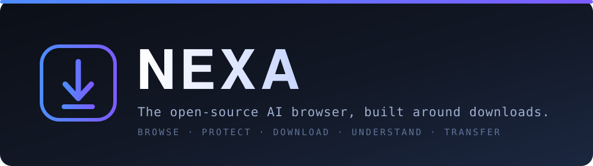
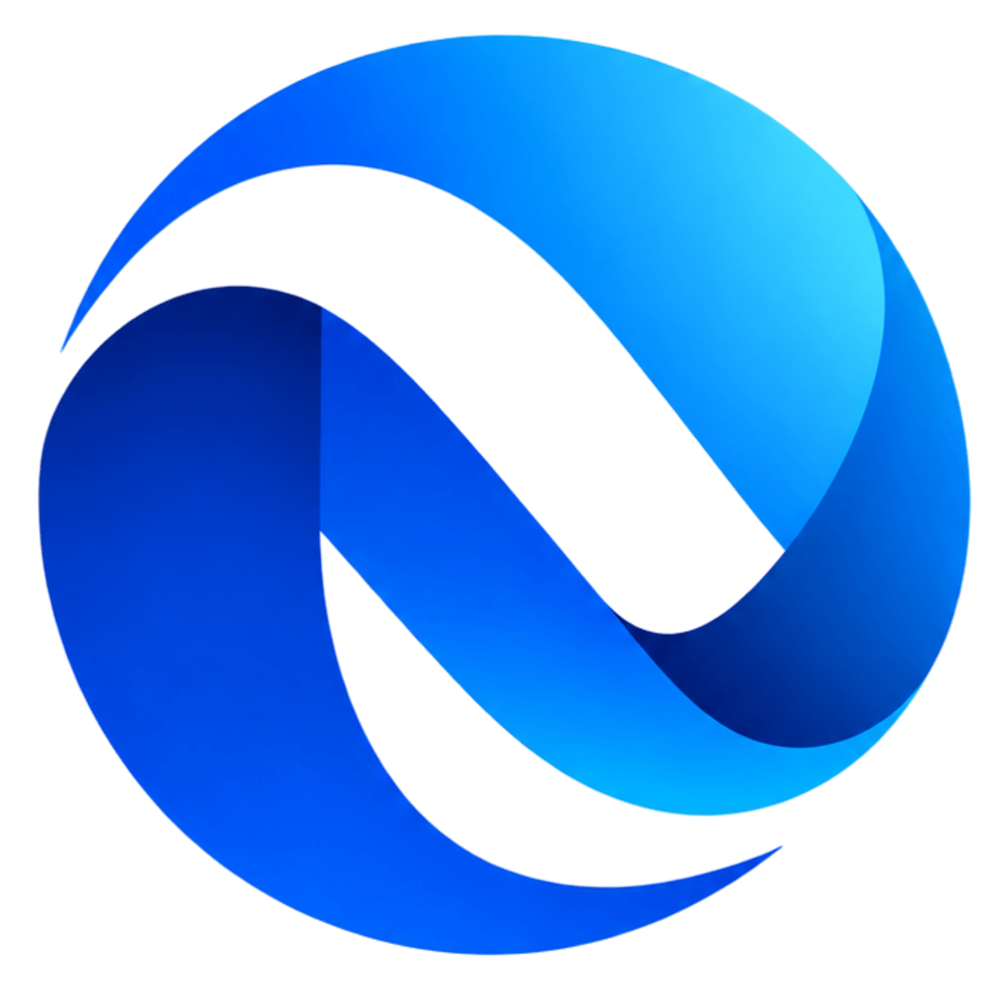

<p align="center">
  
</p>

<h1 align="center">NEXA</h1>

<p align="center">
  <strong>The open-source, privacy-first AI browser — built around downloads.</strong><br/>
  Browse · Protect · Download · Understand · Transfer
</p>

<p align="center">
  <a href="https://github.com/Mostafijemon24/Nexa-AI-Browser/releases/latest"></a>
  <a href="https://github.com/Mostafijemon24/Nexa-AI-Browser/actions/workflows/ci.yml"></a>
  
  
  
  
</p>

---

## What is NEXA?

NEXA is a Chromium desktop browser that treats **downloading, privacy and on-device AI as first-class features** instead of add-ons. It is built on Electron + React + TypeScript with a security-first architecture: a sandboxed renderer, a strictly-typed IPC bridge (no generic filesystem or shell access), a local encrypted password vault, and an AI layer that prefers your own hardware.

Every capability that needs an external service, a signed helper, or a provider key is **honest about it**: the UI shows `NOT CONFIGURED` rather than pretending. Nothing phones home by default.

<p align="center">
  
</p>

## Highlights

| | Feature | What it does |
|---|---|---|
| 🧭 | **Browse** | Fast multi-tab Chromium browsing with per-profile sessions, private tabs, bookmarks, history and collections. Tabs stay alive in the background — switching never reloads the page. |
| 🛡️ | **Protect** | Built-in ad / tracker / annoyance blocking with per-site controls, a Privacy Center with local network diagnostics, and deny-by-default site permissions. |
| ⬇️ | **Download** | A real download manager: pause / resume / retry, safe filename handling, duplicate policies, and a dedicated Downloads surface. |
| 🧠 | **Understand** | On-device AI (Ollama) and an optional AI gateway for page Q&A, summarize and rewrite — page content is always treated as untrusted data. |
| 🤖 | **Agent** | An opt-in browser agent that plans one step at a time; NEXA authorizes every sensitive action. It never submits forms, logs in, pays, or enters your saved passwords. |
| 🔐 | **Vault** | A local password manager — AES-256-GCM + PBKDF2 (210k) in the main process, autofill that never exposes secrets to the page or the AI. |
| 🌐 | **VPN** | WireGuard tunnels through a privileged helper that never reports *Protected* without a real handshake. |
| 🧩 | **Extensions** | Load unpacked Chromium (MV3) extensions with a strict permission allow-list. |
| ☁️ | **Transfer** | Google Drive read/download handoff into the same download engine (OAuth with PKCE; tokens stay in OS secure storage). |

## Download

Ready-to-use installers for **Windows, macOS and Linux** are published on the releases page:

### ➡️ [Download the latest release](https://github.com/Mostafijemon24/Nexa-AI-Browser/releases/latest)

| OS | File |
|---|---|
| 🪟 Windows | `NEXA-Setup-<version>.exe` (NSIS installer) |
| 🍎 macOS | `NEXA-<version>.dmg` / `NEXA-<version>-mac.zip` |
| 🐧 Linux | `NEXA-<version>.AppImage` / `nexa_<version>_amd64.deb` |

> Builds are produced automatically by the [Release workflow](.github/workflows/release.yml) whenever a version tag is pushed. Installers are **unsigned** unless code-signing certificates are configured as repository secrets (see [Releasing](#releasing)); unsigned apps may show an OS warning on first launch.

## Getting started (from source)

```bash
# Requirements: Node.js 22+, npm
git clone https://github.com/Mostafijemon24/Nexa-AI-Browser.git
cd Nexa
npm install
npm run dev      # launch the app in development
```

Quality gates:

```bash
npm run typecheck   # strict TypeScript across main / renderer / server
npm run lint        # ESLint (zero warnings)
npm test            # Vitest unit suite
```

## Enabling AI (fixing "AI not connected")

NEXA ships with **no AI provider enabled by default** — that is why the AI panel reads *not connected* on a fresh install. Pick either option:

- **Local AI (recommended, fully private):** install [Ollama](https://ollama.com), then pull a model, e.g. `ollama pull llama3.2`. NEXA auto-detects Ollama on `http://127.0.0.1:11434`. No key, nothing leaves your machine.
- **NEXA AI Gateway (optional):** run the bundled server in [`server/`](server/) and point the app at it by setting `MAIN_VITE_NEXA_AI_GATEWAY_URL` at build time (see [`.env.example`](.env.example) and [`server/.env.example`](server/.env.example)).
- **Bring-your-own key (optional):** add an OpenAI / Anthropic key in **Settings → AI**; keys are stored in OS secure storage and never cross the renderer bridge.

The browser agent and page Q&A use whichever provider is connected.

## Configuration

| Area | How to configure |
|---|---|
| AI gateway URL | `MAIN_VITE_NEXA_AI_GATEWAY_URL` (build-time, public URL only — never a key) |
| Local AI | Install Ollama; auto-detected on loopback |
| VPN | Import a WireGuard config; a signed privileged helper must be installed for real tunnels (see `NEXA_P4_2_SIGNING_AND_INSTALLER.md`) |
| Google Drive | Connect from the Drive surface (OAuth with PKCE) |
| Provider keys | **Settings → AI** → stored in OS secure storage |

> Secrets never belong in the repo. Copy `.env.example` only for local development; runtime secrets live in OS secure storage.

## Security model

- **Sandboxed renderer**, `contextIsolation` on, **no Node in the page**.
- **Typed IPC only** — every channel validates its payload with Zod; there is no generic filesystem, shell, or `eval` bridge.
- **Vault**: AES-256-GCM with PBKDF2 (210k, SHA-256); the key lives only in main-process memory while unlocked; autofill injects secrets directly into the guest page and never returns them to the renderer or the AI.
- **Agent**: SSRF-guarded (no loopback / LAN / cloud-metadata), exfiltration-guarded navigation, enforced *never submit / log in / pay*, and no automatic entry into password / card / OTP fields.
- **VPN**: the privileged helper exposes only an allow-listed set of WireGuard operations over a 0600 socket, runs every tool with a fixed `PATH`, and never reports *Protected* without a real handshake.
- **Web content is untrusted data** everywhere it reaches the model — fenced and guarded against prompt injection.
- **Privacy toggles default off** except a Secure-DNS preference; nothing is uploaded without explicit action.

A reviewer's note: on Linux, OS secure storage may fall back to a weak backend when no keyring is present — prefer a system with a keyring for long-lived tokens.

## Architecture

```
src/
  main/        Electron main process — services (vault, downloads, vpn, ai, agent, drive, …) + typed IPC
  preload/     contextBridge surface (the only thing the page can call)
  renderer/    React UI (tabs, panels, views, design system)
  shared/      pure, unit-tested contracts (schemas, parsing, agent/AI/page-content pipelines)
  core/        vault crypto
  helper/      standalone privileged VPN helper (built + signed separately)
  platform/    per-OS adapters
server/        optional NEXA AI Gateway (standalone Node service)
```

Design and implementation audits live in the `NEXA_*.md` documents and [`docs/`](docs/).

## Releasing

1. Bump `version` in `package.json`.
2. Tag and push:
   ```bash
   git tag v0.1.1
   git push origin v0.1.1
   ```
3. The [Release workflow](.github/workflows/release.yml) builds on Windows, macOS and Linux runners and uploads the installers to a GitHub Release.

For **signed** builds, add these repository secrets (the workflow uses them automatically, and skips signing when they are absent):

| Secret | Platform |
|---|---|
| `CSC_LINK`, `CSC_KEY_PASSWORD` | Windows + macOS code-signing certificate (base64) |
| `APPLE_ID`, `APPLE_APP_SPECIFIC_PASSWORD`, `APPLE_TEAM_ID` | macOS notarization |

## Author

Created and maintained by **[Mostafijemon24](https://github.com/Mostafijemon24)**.

## License

[MIT](LICENSE) © Mostafijemon24
